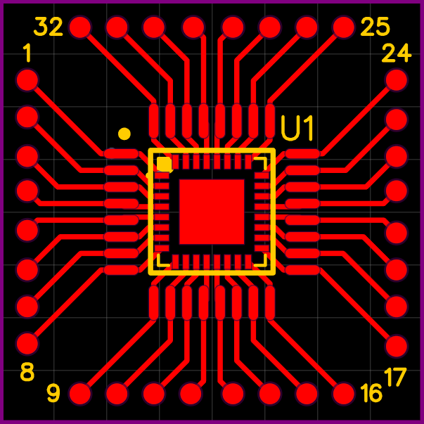

# TQFP32 / QFN32 Breakout Board

A compact PCB that brings the pins of a 32-pin TQFP or QFN device out to individual solder pads.

## Overview

| Property | Details |
| --- | --- |
| Board dimensions | 20.32 × 20.32 mm |
| Package target | TQFP32 / QFN32 |
| Pad diameter | 0.5 mm |
| Design software | EasyEDA Standard 6.5.51 |
| Design source | [easyeda/PCB.json](./easyeda/PCB.json) |

The board is intended for prototyping with compatible 32-pin surface-mount ICs, including devices in the ATmega328P family/package options where the footprint and pinout match.

## Features

- Exposes the 32 package pins as individual solder pads.
- Small 20.32 mm square PCB footprint.
- No onboard voltage regulator, crystal, or additional support circuitry.
- Suitable as a simple breakout for external wiring and experimentation.

## Important before use

This is a passive breakout PCB, not a complete development board. It does not provide power regulation, clock circuitry, programming hardware, or protection for the connected IC.

Before soldering or applying power:

1. Confirm that your IC uses the exact package and pinout supported by the PCB.
2. Check the pin numbering and orientation against the schematic and PCB files.
3. Provide the required power, clock, reset and support components externally.
4. Use suitable fine-pitch soldering equipment; the pads are small.

Do not assume that every TQFP32 or QFN32 device has the same pin assignment. Package size alone does not guarantee pinout compatibility.

## Design files

- [EasyEDA PCB source](./easyeda/PCB.json)
- [PCB render](./images/pcb_render.png)

You can inspect or adapt the source in EasyEDA. Verify the generated manufacturing outputs before ordering boards.

## License

See the repository's [LICENSE](./LICENSE) file for the applicable license terms.

## Links

- [GitHub repository](https://github.com/ruzgar-mcu-wizard/tqfp32-qfn32-breakout)
- [YouTube channel](https://www.youtube.com/channel/UCh0Gprh0Ou6Ah2s-69SvjJQ)
- [Custom ROM Vault](https://rom-kasasi.netlify.app/)

Questions or collaboration ideas: **ruzgarefecelik67@gmail.com**
